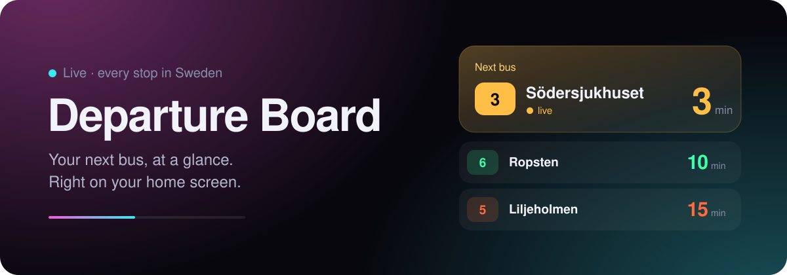
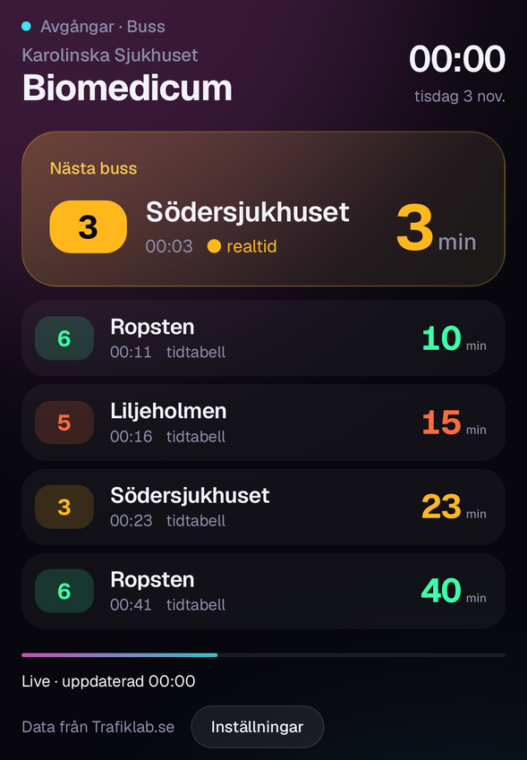

<p align="center">
  
</p>

<p align="center">
  <a href="https://hammarlund99.github.io/departure-board/"></a>
  
  
  
</p>

<br>

<table>
  <tr>
    <td width="46%" valign="top">
      
    </td>
    <td valign="top">
      <h3>Stop guessing. Start walking.</h3>
      <p>Departure Board shows the next buses from your stop, live, in a calm screen you can read in one glance. The next bus gets the big card. The ones after it line up below, each in its own colour.</p>
      <p>Add it to your home screen and it opens like an app, full screen, with no app store involved.</p>
      <p>
        ● <b>Live countdown</b> in minutes, with delays<br>
        ● <b>Realtime or timetable</b>, clearly marked<br>
        ● <b>Any stop in Sweden</b>, Biomedicum by default<br>
        ● <b>Pick your directions</b> and hide the rest<br>
        ● <b>Svenska or English</b>, follows your phone<br>
        ● <b>Your own key</b>, stored only on your device
      </p>
    </td>
  </tr>
</table>

<br>

## Get started in two minutes

| | |
|:--:|:--|
| **1** | **Get a free API key.** Create a project at [developer.trafiklab.se](https://developer.trafiklab.se) and add **Trafiklab Realtime APIs**. |
| **2** | **Open the app** at [hammarlund99.github.io/departure-board](https://hammarlund99.github.io/departure-board/), tap **Settings** and paste your key. |
| **3** | **Add it to your home screen.** iPhone: Share → *Add to Home Screen*. Android: menu → *Install app*. |

That's it. The board starts on Karolinska Sjukhuset Biomedicum. Change the stop under **Settings** whenever you like.

<br>

## Make it yours

**Choose your stop.** Type a stop name under Settings, for example `Odenplan` or `Solna centrum`. The header updates to the stop you picked.

**Hide directions you never take.** Every line and end station the board has seen shows up in Settings. Untick the ones you don't need and they disappear from the board.

**Switch language.** Svenska or English, picked from your phone's language. Change it at the top of Settings. Stop names and destinations stay as they appear on SL's signs.

<br>

## Good to know

- **Your key stays with you.** It is saved in your browser only and sent straight to Trafiklab. Nothing passes through any other server.
- **Updates every minute.** That is about 43,000 calls a month, well inside Trafiklab's free Bronze limit of 100,000.
- **"Scheduled" is normal.** SL sends live times once a bus is on its way, so buses further down the list show their timetable time until they get closer.
- **Don't share a link with `?key=` in it.** That shares your key. Send the plain link and let everyone add their own.

<br>

## Under the hood

One HTML file, no framework and no build step. GitHub Pages serves it as is.

```
index.html               the whole app: layout, styles and logic
manifest.webmanifest     app name, icons and full-screen mode
assets/                  app icons, README banner and screenshot
```

The app calls two [Trafiklab Realtime API](https://www.trafiklab.se/api/our-apis/trafiklab-realtime-apis/) endpoints:

```
GET https://realtime-api.trafiklab.se/v1/stops/name/{search}?key=…     find the stop
GET https://realtime-api.trafiklab.se/v1/departures/{stopId}?key=…     next departures
```

**Run your own copy:** fork this repository, then turn on GitHub Pages under *Settings → Pages → Deploy from a branch → main → / (root)*.

<br>

---

<p align="center">
  Made by <b>Lisa Hammarlund</b><br>
  <sub>Data from <a href="https://www.trafiklab.se">Trafiklab.se</a>, licensed under <a href="https://creativecommons.org/licenses/by/4.0/">CC BY 4.0</a>.</sub>
</p>
